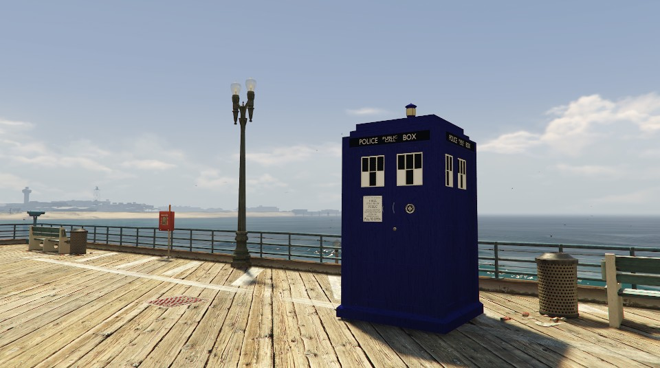

# TARDIS para GTA V



A TARDIS de Doctor Who no modo história do GTA V Enhanced. Ela é um port do addon TARDIS Rewrite do Garry's Mod: você entra, pilota em terceira pessoa, voa, flutua com a antigravidade e viaja até o waypoint do mapa com a desmaterialização e os sons originais.

Também tem freio de mão, camuflagem, physlock, um escudo que devolve os ataques e um painel com o estado de cada sistema. O texto do painel segue o idioma do jogo (inglês ou português).

## Requisitos

- GTA V Enhanced (Steam), só no modo história
- [Script Hook V](http://www.dev-c.com/gtav/scripthookv/), numa versão compatível com a sua versão do jogo
- [OpenRPF](https://www.gta5-mods.com/tools/openrpf-openiv-asi-for-gta-v-enhanced), que carrega a pasta `mods` no Enhanced
- [CodeWalker](https://github.com/dexyfex/CodeWalker), só para o passo 3 da instalação

## Instalação

1. Instale o Script Hook V e o OpenRPF na pasta do jogo (a que tem `GTA5_Enhanced.exe`).
2. Baixe o `TARDIS-<versão>.zip` da página de [Releases](../../releases) e extraia tudo na pasta do jogo. O zip já vem com as pastas no lugar certo:
   ```
   TARDIS.asi
   TARDIS.ini
   TARDIS\sounds\, TARDIS\translations\
   mods\update\x64\dlcpacks\tardis\dlc.rpf
   ```
3. Registre o pacote da TARDIS no jogo. Se você ainda não tem `mods\update\update.rpf`, copie o `update\update.rpf` do jogo para lá. Abra esse arquivo da pasta `mods` no CodeWalker (RPF Explorer, com o modo de edição ligado), edite `common\data\dlclist.xml` e acrescente esta linha antes de `</Paths>`:
   ```xml
   <Item>dlcpacks:/tardis/</Item>
   ```
   Uma atualização do GTA substitui o `update.rpf`, então esse passo precisa ser refeito depois de cada uma.
4. Abra o jogo e aperte F5 para chamar a TARDIS. Chegue perto e aperte E para entrar.

Para desinstalar, apague `TARDIS.asi`, `TARDIS.ini`, a pasta `TARDIS` e `mods\update\x64\dlcpacks\tardis`, e tire a linha do `dlclist.xml`.

## Controles

Estes são os padrões, iguais aos do TARDIS Rewrite. Todos podem ser trocados no `TARDIS.ini`.

| Tecla | Ação |
|---|---|
| F5 | Chamar ou remover a TARDIS |
| E | Entrar e sair |
| H | Viajar até o waypoint do mapa |
| R | Voo |
| T | Antigravidade |
| J | Freio de mão (interrompe o voo ou a viagem) |
| L | Camuflagem |
| G | Physlock |
| K | Escudo |
| W A S D, Espaço, Ctrl | Mover, subir, descer |
| Shift | Boost |
| Num 8 / Num 5 / Num 0 | Mais rápido, mais devagar, velocidade padrão (com Num Lock ligado) |

Se você sair da TARDIS no ar, o personagem sai na altura dela com um paraquedas.

## Compilar

Precisa do Visual Studio 2022 (ou Build Tools) com C++ e do SDK do Script Hook V em `third_party\shv`. Rode `build.bat` para gerar `build\TARDIS.asi` e `tests\run_tests.bat` para os testes. `pwsh -File tools\package.ps1 <versão>` monta o zip da release.

## Créditos

- Modelo da TARDIS: [Doctor Who: The TARDIS](https://www.gta5-mods.com/vehicles/doctor-who-the-tardis-mod), no GTA5-Mods
- Sons e inspiração: [TARDIS Rewrite](https://steamcommunity.com/sharedfiles/filedetails/?id=307175678), addon do Garry's Mod
- [Script Hook V](http://www.dev-c.com/gtav/scripthookv/), de Alexander Blade
- [miniaudio](https://miniaud.io/), para o áudio
